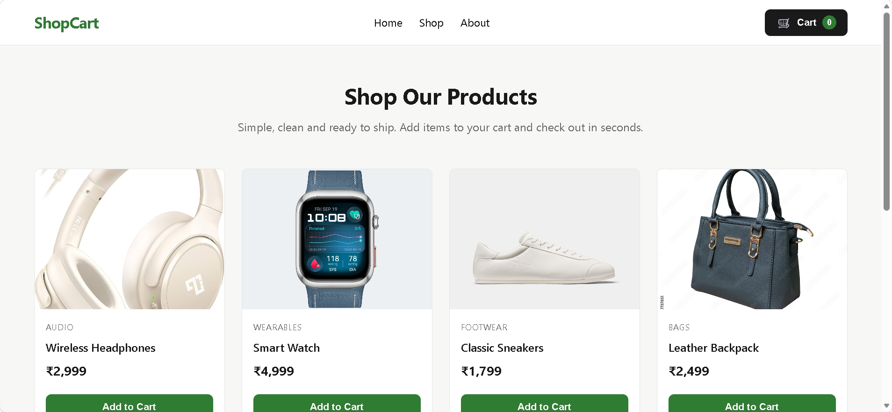
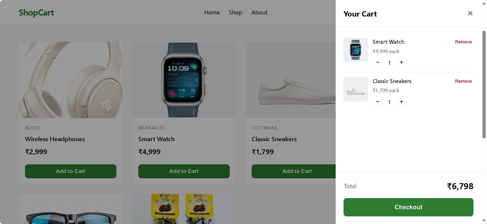

# 🛒 ShopCart – E-Commerce Shopping Cart

A simple, responsive e-commerce shopping cart application built using **HTML, CSS, and JavaScript**. ShopCart provides a clean shopping experience where users can browse products, add items to their cart, manage quantities, and view the total price dynamically.

🌐 **Live Demo:** [ShopCart](https://vankayalavamsi.github.io/E-Commerce-Shopping-Cart/)

## 📸 Screenshots

### Products Page



### Shopping Cart



## ✨ Features

* **Product Listing:** Displays products with images, names, categories, and prices.
* **Add to Cart:** Add products to the shopping cart with a single click.
* **Dynamic Cart Counter:** Automatically updates the cart item count.
* **Quantity Management:** Increase or decrease product quantities.
* **Remove Products:** Remove individual items from the cart.
* **Automatic Price Calculation:** Updates the cart total whenever quantities change.
* **Shopping Cart Drawer:** View cart items in a convenient side panel.
* **Empty Cart Handling:** Displays an empty-cart message when no products are available.
* **Checkout Interaction:** Provides an order confirmation message and clears the cart.
* **Responsive Design:** Adapts the interface for mobile and desktop screens.

## 🛠️ Technologies Used

| Technology       | Purpose                                  |
| ---------------- | ---------------------------------------- |
| HTML5            | Structure and content                    |
| CSS3             | Styling, layout, and responsive design   |
| JavaScript       | Product rendering and cart functionality |
| DOM Manipulation | Dynamic updates to the interface         |

## 📦 Available Products

The application includes six products across different categories:

| Product             | Category    |  Price |
| ------------------- | ----------- | -----: |
| Wireless Headphones | Audio       | ₹2,999 |
| Smart Watch         | Wearables   | ₹4,999 |
| Classic Sneakers    | Footwear    | ₹1,799 |
| Leather Backpack    | Bags        | ₹2,499 |
| Sunglasses          | Accessories |   ₹899 |
| Ceramic Coffee Mug  | Home        |   ₹499 |

## 📁 Project Structure

```text
E-Commerce-Shopping-Cart/
│
├── index.html
├── styles.css
├── script.js
├── README.md
│
├── screenshots/
│   ├── products.png
│   └── cart.png
│
└── assets/
    ├── headphones.jpg
    ├── watch.jpg
    ├── sneakers.jpg
    ├── backpack.jpg
    ├── sunglasses.jpg
    └── mug.webp
```

## 🚀 Getting Started

Follow these steps to run the project locally.

### 1. Clone the Repository

```bash
git clone https://github.com/vankayalavamsi/E-Commerce-Shopping-Cart.git
```

### 2. Navigate to the Project Directory

```bash
cd E-Commerce-Shopping-Cart
```

### 3. Run the Application

Open `index.html` directly in your browser.

Alternatively, use the **Live Server** extension in Visual Studio Code to launch the application locally.

## 🛍️ How It Works

1. Open the application and browse the available products.
2. Click **Add to Cart** to add a product.
3. Click the cart icon to open the shopping cart.
4. Use the `+` and `−` buttons to update product quantities.
5. Click **Remove** to delete a product from the cart.
6. View the automatically calculated total price.
7. Click **Checkout** to complete the demo checkout interaction.

## ⚙️ Core Functionality

The application uses JavaScript to manage product data and shopping cart operations.

* Products are stored in a JavaScript array.
* Product cards are dynamically generated using DOM manipulation.
* Cart operations are handled using JavaScript functions.
* Array methods such as `find()`, `filter()`, `map()`, and `reduce()` help manage cart data.
* The cart counter and total amount are recalculated whenever the cart changes.

## 🔮 Future Improvements

* Add product search and category filtering.
* Implement cart persistence using LocalStorage.
* Introduce user authentication.
* Integrate a backend and database.
* Add a real payment gateway.
* Implement order history and tracking.

## 👨‍💻 Author

**Vankayala Vamsi**

* GitHub: [@vankayalavamsi](https://github.com/vankayalavamsi)
* Live Project: [ShopCart](https://vankayalavamsi.github.io/E-Commerce-Shopping-Cart/)

## 📄 License

This project is available for educational and learning purposes.
